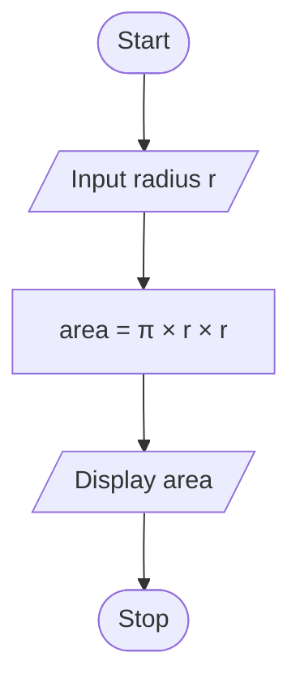
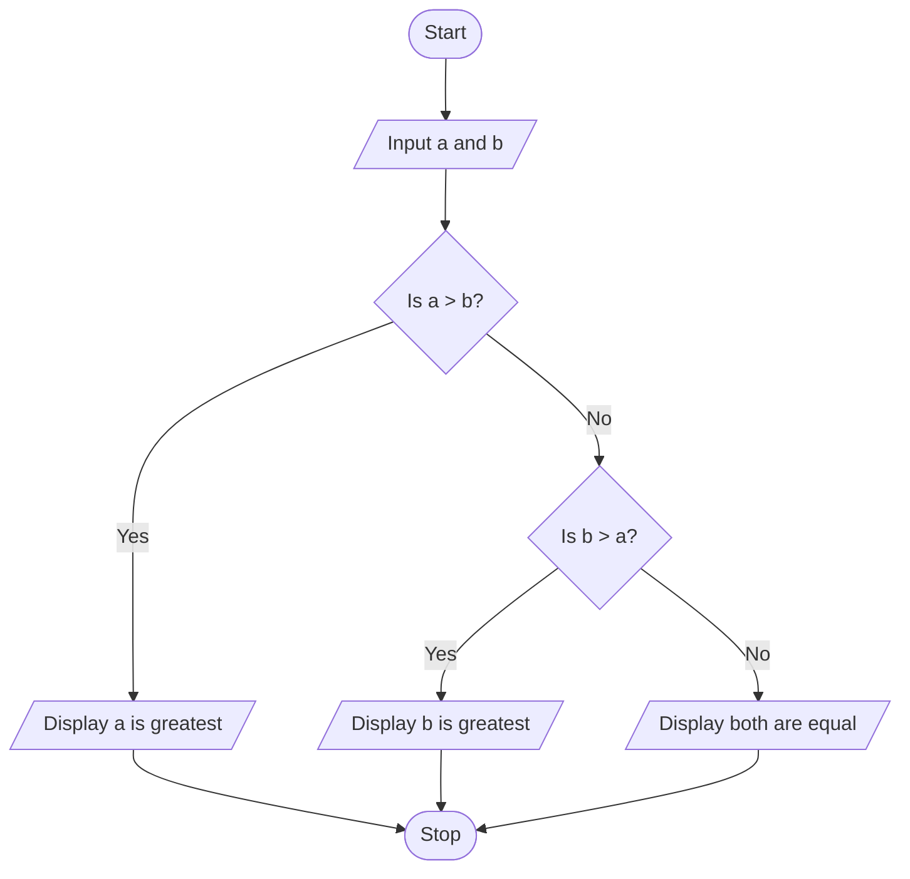
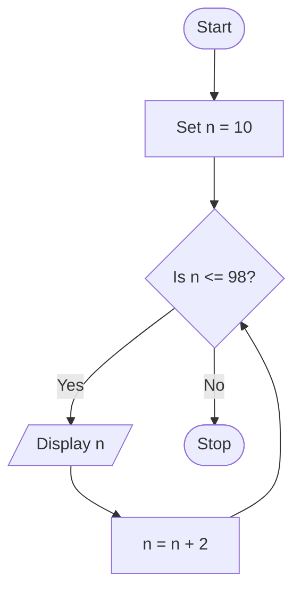
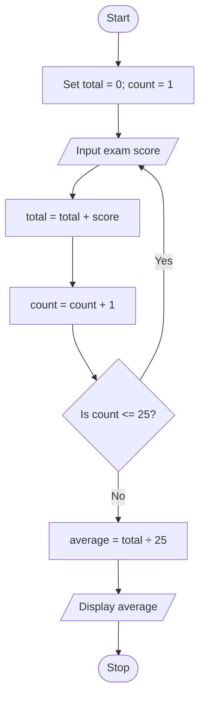

# Flowchart Solutions

## Question 1: Calculate the Area of a Circle

### Formula

`Area = π × radius × radius`

Use `π = 3.14159` or the value provided by the programming language.

### Algorithm

1. Start.
2. Input the radius `r`.
3. Calculate `area = π × r × r`.
4. Display the area.
5. Stop.

### Flowchart

---

## Question 2: Find the Greatest of Two Numbers

### Algorithm

1. Start.
2. Input two numbers `a` and `b`.
3. If `a > b`, display `a` as the greatest.
4. Otherwise, if `b > a`, display `b` as the greatest.
5. If neither number is greater, display that both numbers are equal.
6. Stop.

### Flowchart

---

## Question 3: Find the Even Numbers Between 9 and 100

The even numbers strictly between 9 and 100 are the numbers from 10 through 98 that are divisible by 2.

### Answer

`10, 12, 14, 16, 18, 20, 22, 24, 26, 28, 30, 32, 34, 36, 38, 40, 42, 44, 46, 48, 50, 52, 54, 56, 58, 60, 62, 64, 66, 68, 70, 72, 74, 76, 78, 80, 82, 84, 86, 88, 90, 92, 94, 96, 98`

### Algorithm

1. Start.
2. Set `n = 10`.
3. Check whether `n <= 98`.
4. If yes, display `n` and increase `n` by 2.
5. Repeat step 3.
6. If no, stop.

### Flowchart

---

## Question 4: Calculate the Average of 25 Exam Scores

### Formula

`Average = Total of all scores ÷ 25`

### Algorithm

1. Start.
2. Set `total = 0` and `count = 1`.
3. Input the next exam score.
4. Add the score to `total`.
5. Increase `count` by 1.
6. If `count <= 25`, repeat from step 3.
7. Calculate `average = total ÷ 25`.
8. Display the average.
9. Stop.

### Flowchart

## Notes

- In Question 3, “between 9 and 100” is treated as excluding both endpoints, so the sequence starts at 10 and ends at 98. If the question intended an inclusive range, include 100 as well.
- The diagrams use Mermaid syntax. They can be previewed in VS Code with a Mermaid-compatible Markdown extension or on a Mermaid editor.
- Each question now has a separate folder containing its pseudocode, Mermaid flowchart source, and Java code. See [README.md](./README.md) for the complete structure.
